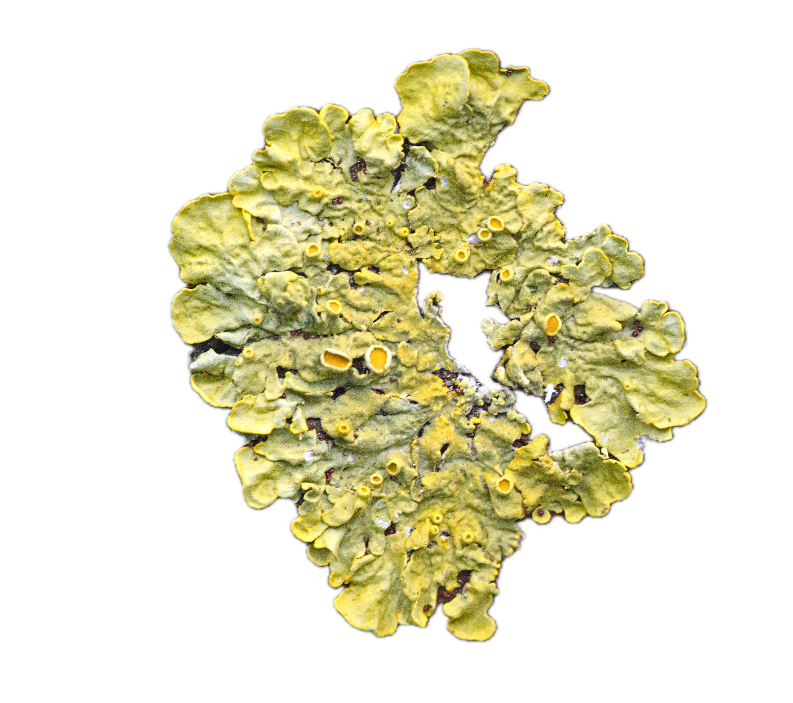

---
# You don't need to edit this file, it's empty on purpose.
# Edit theme's home layout instead if you wanna make some changes
# See: https://jekyllrb.com/docs/themes/#overriding-theme-defaults
layout: single
author_profile: true
classes: wide
---

# Hi!

## This website is currently under construction. A new version will be available soon!
### In the meantime, feel free to reach out to me at my [email](mailto:kelmer.martins@su.se).



I am a master's student in plant, algae, and fungi biology at the Federal University of Santa Catarina (Florianópolis, Brazil), and I have been working in mycology for the past five years. My current research involves understanding data shortfalls and biases associated with Neotropical *Fungi* digitally accessible knowledge, and developing habitat suitability models to aid fungal conservation.

My interests are all related to fungi, especially ecology, genomics, and conservation. Throughout my scientific formation, I
became interested in bioinformatics, learning essential computational tools to develop meaningful work in soil fungal
community ecology, metabarcoding, and metagenomics. As a scientist in formation and a young mycologist who understands the utter
importance of the Funga, I naturally became interested and involved in fungal conservation, working on assessing fungal species extinction risk based on IUCN criteria. I have participated in around 40 global fungal species assessments, being now a reviewer for the [Global Fungal Red List Initiative](https://redlist.info/en/iucn/welcome), and a certificated trainer of the IUCN Red List Unit. Also, I am a member of the [IUCN SSC Brazil Fungal Specialist Group](https://www.iucnbrazfun.com/) and the [MIND.Funga research group](https://mindfunga.ufsc.br/?lang=en).


